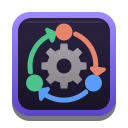

<p align="center">
  
</p>

# cross-agent

[](https://github.com/jean1880/nuvek-cross-agent/actions/workflows/ci.yml)
[](LICENSE)

Delegate a prompt from one AI coding harness to another, headless, with a wall-clock timeout and
rate-limit detection. `cross-agent` runs Antigravity (`agy`), Claude Code (`claude`) or Codex
(`codex`) as a child process, bounds it, classifies a quota failure as exit 75 instead of a generic
error, and can print one JSON receipt instead of the raw output.

It exists so an agent in one harness can get a fresh-eyes review or a second opinion from a model
of another family, and so a script can tell "try again later" from "failed".

> **Antigravity notice:** Google has restricted Antigravity accounts for use
> of third-party tools that bypassed Google's supplied tooling. cross-agent drives the
> Google-supplied `agy` CLI rather than bypassing it, but Google has not said whether a
> tool that drives that CLI is exempt from its third-party-tools rule. Google controls
> enforcement and may change its rules or restrict access at its discretion. Use it only
> if you accept that risk; this project makes no promise that access will remain
> available. See [Google's Antigravity Terms](https://www.antigravity.google/terms) and
> its [account-restriction notice](https://discuss.ai.google.dev/t/update-on-antigravity-tos-ban/131424).

cross-agent is an independent project. It is not affiliated with, endorsed by or sponsored by
Google, Anthropic or OpenAI. It drives their command-line tools, which you install and sign in to
yourself.

## Features

- One bounded, headless delegation to Antigravity, Claude Code or Codex, with a wall-clock timeout.
- Quota and rate-limit failures exit 75, so a script can tell "try again later" from "failed".
- An optional JSON receipt: outcome, exit code, duration, model and effort, a prompt digest and
  scrubbed output.
- `status` and `select` rank the models each harness offers by capability tag, tier and headroom.
- Secrets are scrubbed from logs, the ledger and receipts; the prompt itself is never stored.

## Requirements

- Linux, x86_64 for the release binaries.
- Rust 1.90 or newer when building from source.
- The harness CLIs you want to delegate to (`agy`, `claude`, `codex`) on your `PATH` and signed in.

## Install

```bash
cargo install --git https://github.com/jean1880/nuvek-cross-agent --tag v1.0.0
```

Or download a static x86_64 binary from the
[releases page](https://github.com/jean1880/nuvek-cross-agent/releases) and check it against
`SHA256SUMS`:

```bash
sha256sum --check --ignore-missing SHA256SUMS
```

A Debian package can be built with `cargo install cargo-deb` and `cargo deb`.

cross-agent is not published to crates.io (`publish = false`): install it from the release
binaries, the Debian package or `cargo install --git`.

## Quick start

```bash
cross-agent status
cross-agent claude --model opus "Review this diff for correctness"
cross-agent agy --model flash --timeout 300 --json "Review this diff for correctness"
cross-agent select --tag code --tier deep --from claude
```

More examples, every flag and the exit codes (0, 1, 2, 4, 75, 78, 124) are in
[docs/usage.md](docs/usage.md). Environment variables, model tags and the secret-surface
configuration are in [docs/configuration.md](docs/configuration.md).

## Known limitations

- **The prompt travels as a command-line argument** to the harness CLI, so other local users can
  see it in the process list while the run lasts. See [SECURITY.md](SECURITY.md).

## Development

```bash
cargo fmt --all -- --check
cargo clippy --all-targets -- -D warnings
cargo test
cargo deny check licenses bans sources
```

`nuvek-core` is a crates.io dependency (`version = "1"`).

## Related projects

- [nuvek-core](https://github.com/jean1880/nuvek-core): the shared library (secret scrubbing, journald logging) this tool builds on
- [nuvek-agent-terminal](https://github.com/jean1880/nuvek-agent-terminal): writes the usage and catalogue files that `status` and `select` read
- [nuvek-agent-sync](https://github.com/jean1880/nuvek-agent-sync) and [nuvek-agent-config](https://github.com/jean1880/nuvek-agent-config): one agent configuration, rendered into several tools
- [nuvek-hive-board](https://github.com/jean1880/nuvek-hive-board): a message board for coordinating agent teams

## Support

If cross-agent saves you time, you can support its development:

- [Ko-fi](https://ko-fi.com/jean1880)

## Contributing

See [CONTRIBUTING.md](CONTRIBUTING.md). Security reports go through [SECURITY.md](SECURITY.md).

## Licence

Released under the [MIT Licence](LICENSE). Copyright (c) 2026 Jean-Luc Desroches.
